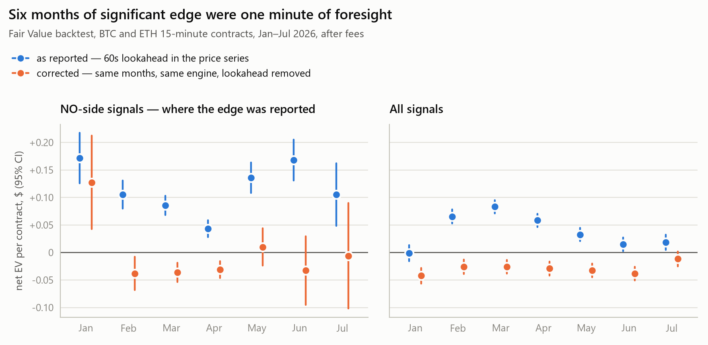
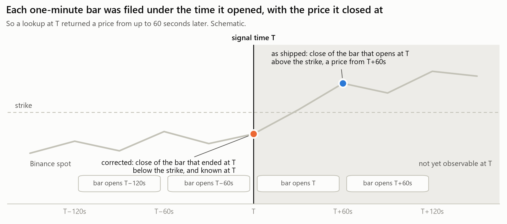
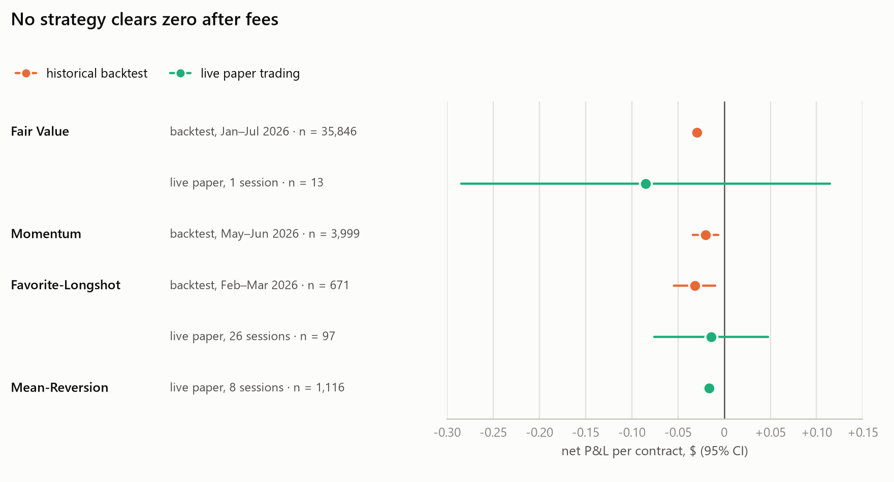

# Four strategies on Kalshi's 15-minute crypto markets, and the backtest bug that faked an edge

[](https://github.com/simonziervogel/trading-bot/actions/workflows/tests.yml)

A research and paper-trading codebase for [Kalshi](https://kalshi.com)'s
15-minute BTC and ETH contracts, which pay out if the price finishes above
where it opened. It tests four strategy ideas with historical backtests and
simulated live trading.

**None of the four has an edge after fees.** The most useful result is how the
one that looked profitable was taken apart: a backtest edge that was
statistically significant in six consecutive months turned out to be 60 seconds
of lookahead in a price series.

No real orders are placed anywhere in this repo. Live runs are simulated fills
against production market data.



| Fair Value, Jan–Jun 2026 | As reported | Corrected |
|---|---|---|
| NO-side signals | 9,563 | 7,358 |
| Win rate | 58.6% | 38.7% |
| Net EV per contract | **+0.086** (z = +20) | **−0.028** (95% CI −0.038 to −0.018) |
| Months with a positive, significant edge | 6 of 6 | 1 of 6 |

The one remaining month, January, is an unexplained residual concentrated on
three days, and the post-mortem
[reports it as such](docs/postmortem.md#the-january-residual).

The full analysis is in **[docs/postmortem.md](docs/postmortem.md)**; the same
results with code are in **[analysis.ipynb](analysis.ipynb)**.

## What went wrong



The Fair Value strategy prices each contract as a digital option, using Binance
spot and realized volatility, and trades where the model disagrees with
Kalshi's quote. The backtest loaded Binance's one-minute bars and stored each
one under the time it **opened**, with the price it **closed** at. A bar that
opens at T closes at T+60s, so asking for "the price at T" returned a price
from up to a minute later.

On a 15-minute contract that is decisive. The model's whole scale is about 20
basis points, and one minute of BTC movement is about 5.5. The fix was one
expression: `open_time_ms + interval_ms`.

Removing the lookahead exposed a second, independent problem. These contracts
settle on a CF Benchmarks index, and Binance spot sits a median 5.2 basis
points away from it. Near the strike, where most signals are, Binance's own
15-minute move disagrees with the actual settlement up to 36% of the time. No
model built on that proxy can resolve these contracts there.

## What caught it, and what changed

A train/test split, six separate months, a screen across eight instruments and
the correction of an unrelated fill-price error all passed on the faulty data,
because they all shared it. Unit tests passed too: the price lookup and the
backtest engine were each correct, and the error sat in how raw bars became
timestamps between them.

A two-hour simulated live run was what disagreed. It lost money where the
backtest said it should win clearly, which led to reading the lookup code line
by line.

What the repo has now:

- **An end-to-end no-lookahead test.** It feeds each engine its raw API
  payloads, records the signal at time T, rewrites every input that was not yet
  observable at T, and requires the identical signal. Run against the old
  code path it fails, so it would have caught this bug.
  [`tests/test_no_lookahead_e2e.py`](tests/test_no_lookahead_e2e.py)
- **An audit script** that replays every stored signal with and without the
  lookahead and measures the Binance basis.
  [`audit_fair_value.py`](audit_fair_value.py)
- **A committed data snapshot** in [`data/`](data), so every figure and number
  here can be rebuilt from a fresh clone without API access.

## The four strategies



| Strategy | Hypothesis | How it was tested | Result |
|---|---|---|---|
| **Fair Value** | Kalshi misprices a contract that is a plain digital option | Backtest, seven months; one live session | No edge. The reported edge was a 60-second lookahead; corrected, it loses 3 cents per contract |
| **Momentum** | A move in the contract's price continues into expiry | Backtest with a held-out period | No edge. The first result came from filling at the mid-price |
| **Favorite-Longshot** | Heavy favorites win less often than their price implies | Backtest; 26 live sessions | No edge. A positive US-open session did not replicate with correct fills, and lost live |
| **Mean-Reversion** | Short moves reverse; take profit at 1.5¢, stop at 2.5¢ | Live only, 1,116 simulated trades | No edge: 49% wins while risking more than it gains |

Mean-Reversion has no backtest on purpose. A one-minute candle cannot say
whether the take-profit or the stop was hit first, so a backtest would have
claimed more than the data supports.

## Engineering

```
kalshi/
  client.py          Kalshi API client, RSA-PSS signed requests
  data/              Live market data; historical Binance klines
  strategies/        The four strategies behind one Strategy interface
  backtest/          One engine per backtestable strategy, shared metrics
  live/engine.py     Paper-trading loop with risk limits and cooldowns
  report/            Figures and summary tables, built from data/ only
  utils/             Fees, pricing, time and quote parsing
tests/               136 tests, run in CI on every push
```

- **Fills at the executable price.** Backtests buy YES at the ask and NO at one
  minus the YES bid, never at the midpoint, and charge Kalshi's taker fee
  rounded up to the cent. Filling at the midpoint was the first measurement
  error this project corrected; it had produced Momentum's apparent edge.
- **Significance, not just P&L.** Every result is reported with a Wilson
  confidence interval and a z-score against the price paid, since a 70% win
  rate means nothing if the contracts cost 70 cents.
- **Live risk controls.** A daily-loss circuit breaker, a per-market re-entry
  cooldown and an entry cutoff before session end, shared by all strategies.
- **Config guards as tests.** A test fails if the live configuration drifts
  from the one the backtest validated.

## Reproduce

```bash
python -m venv venv && venv\Scripts\activate      # or: source venv/bin/activate
pip install -r requirements.txt

pytest -q                          # 136 tests
python make_figures.py --tables    # every figure and table, from data/, no API key
```

Running new backtests or a paper-trading session needs Kalshi API credentials;
copy `.env.example` to `.env` and fill them in.

```bash
python backtest_fair_value.py --from 2026-07-01 --to 2026-07-31 --max-markets 100000
python backtest.py --max-markets 500 --plot results/longshot
python runner.py --strategy favorite_longshot --duration-minutes 120
```

## Limitations

- Order-book depth is not modeled; backtests fill at the best quote regardless
  of size.
- Every fill is charged the taker fee, which is the conservative assumption.
- One venue and seven months of history.
- The live run and the backtest select signals by different rules, so they are
  not directly comparable.
- No strategy here has a demonstrated edge. What the repo demonstrates is the
  validation work.

Details and the remaining caveats are in the
[post-mortem](docs/postmortem.md#known-limitations).

## License

[MIT](LICENSE)
