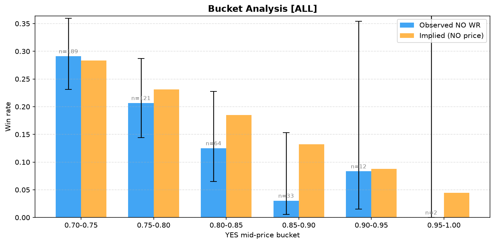
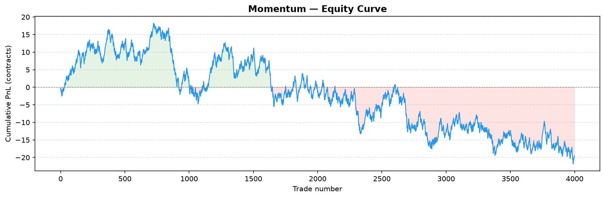

# Kalshi Paper Trading Bot

[](https://github.com/simonziervogel/trading-bot/actions/workflows/tests.yml)

Paper trading bot for [Kalshi](https://kalshi.com) binary markets, focused on 15-minute BTC/ETH price contracts (KXBTC15M, KXETH15M).

Trades are **simulated** — no real orders are placed. All fills use live production market data.



**[analysis.ipynb](analysis.ipynb)** — per-strategy summary, month-by-month
comparison, and out-of-sample validation, all in one place with tables and
charts. Renders fully on GitHub, no setup needed.

## Strategies

Four independent hypotheses, each testing a different kind of market inefficiency.
The two hold-to-expiry strategies (Favorite-Longshot, Momentum) get a full
historical backtest with Wilson-CI significance testing; the two TP/SL,
path-dependent strategies (Mean-Reversion) get validated live via paper
trading instead — 1-min candlesticks can't reliably simulate an intra-candle
TP/SL fill, so pretending to backtest them would overstate confidence. Digital
option fair value is hold-to-expiry too, so it gets the full backtest
treatment despite being the most "model-heavy" of the four.

### FavoriteLongshotStrategy — behavioral bias
Exploits the favorite-longshot bias in prediction markets: contracts priced as
heavy favorites (YES ≥ 0.85) resolve as YES slightly less often than their
price implies. Buy NO, hold to expiry. Entry filters: YES mid ≥ 0.85,
time-to-expiry 5–13 min, spread ≤ 8 cents, no strong BTC/ETH momentum (via
Binance API). **Backtested** — see Key Findings below.

### MomentumStrategy — trend continuation (documented negative result)
Deliberate mirror image of Mean-Reversion: bets a recent price move
*continues* into expiry rather than reverting. If the YES mid has moved by
more than a threshold over a trailing window, buy in the direction of the
move and hold to expiry. **Backtested and out-of-sample tested — the
apparent edge turned out to be a fill-price modeling artifact and
disappears under a corrected, executable-price fill model.** See Key
Findings below; kept as another example (alongside MeanReversion) of a
hypothesis that didn't survive scrutiny.

### FairValueStrategy — digital-option mispricing
Kalshi's KXBTC15M/KXETH15M contracts resolve YES if the reference price at
close is ≥ (or ≤) a strike fixed at market open — i.e. they're literally
cash-or-nothing digital options on "does the price finish above its own
opening level." `kalshi/utils/pricing.py` prices that in closed form (a
zero-drift lognormal model: spot + realized volatility from Binance, strike
+ time-to-expiry from Kalshi) and trades whichever side disagrees with
Kalshi's own quote by more than the round-trip cost. **Retracted: the
reported edge was a 60-second lookahead in the price series, and the model's
Binance proxy cannot resolve these contracts near the strike regardless.**
The post-mortem is the most useful thing in this repo — see Key Findings
below.

### MeanReversionStrategy — reversal (documented negative result)
Buy YES after a down-move showing signs of recovery, NO after an up-move
showing signs of decline. TP/SL-based, so it's **live-only**: in production
paper trading the asymmetric TP/SL parameters (1.5c profit vs 2.5c loss)
produced near-zero edge after fees. Kept as an example of hypothesis-driven
design that didn't pan out, not deleted.

Risk controls in the live engine (`kalshi/live/engine.py`), shared by all four
strategies: a daily-loss circuit breaker (default 20% of starting cash halts
new entries) and a per-ticker re-entry cooldown after each exit.

## Architecture

```
kalshi/
  client.py            Kalshi API client — RSA-PSS signed requests
  data/live.py          Live market data fetcher (public API, no auth)
  data/binance_history.py  Historical Binance klines (fair-value backtest)
  db/ingest.py           SQLite ingestion of paper-trading run results
  strategies/            Strategy implementations (Strategy ABC + Signal)
  backtest/              Historical backtest engines, metrics, charts
    engine.py, metrics.py, charts.py           Favorite-Longshot (NO-only)
    fair_value_engine.py                       Fair-value mispricing
    momentum_engine.py                         Momentum
    common_metrics.py, common_charts.py        Shared side-aware stats/charts
  live/engine.py         Paper trading engine (the live loop, all strategies)
  utils/                 Shared time/fee/market-data/pricing helpers
```

Both `metrics.py` and `common_metrics.py` also compute a Sharpe ratio
(`sharpe_ratio()`) — per-trade mean/stdev of net PnL after fees, plus an
*observed-frequency* annualized version. That annualization is explicitly not
a standard daily-return Sharpe: these are event-driven signals with irregular
spacing, so blindly multiplying by sqrt(252) would overstate confidence the
same way backtesting TP/SL off 1-min candles would (see MeanReversion above).

**Fill model:** all three backtest engines price the recorded economic
outcome (what feeds win-rate/EV/Sharpe) at the *executable* quote —
`yes_ask` for a YES entry, `1 - yes_bid` for a NO entry — never the midpoint,
which was Kalshi's own quoted bid/ask average and was never actually
fillable. `kalshi/utils/market.py`'s `parse_quote()` returns bid, ask, and
mid together; entry-filter/threshold decisions (e.g. Longshot's `mid >=
0.85`) still use mid, since those characterize market consensus rather than
what you'd pay, but every dollar figure that feeds a statistic uses the real
price. `kalshi/utils/fees.py` also rounds the taker fee up to the cent on
the whole order (`ceil(0.07 * price * (1-price) * qty * 100) / 100`),
matching Kalshi's actual rounding rather than leaving it unrounded. See
**Key Findings → Fill Model Fix** below for why this mattered and how much.

`kalshi/backtest/metrics.py` stays NO-side-only (Favorite-Longshot always
trades NO); `common_metrics.py` is a separate, additive module for strategies
that can trade either side — a deliberate "don't abstract prematurely" call
instead of refactoring the original, already-tested pipeline.

Root-level scripts are thin CLI entry points over the package:

| File | Purpose |
|------|---------|
| `runner.py` | Main paper-trading loop — start runs here (`--strategy` selects among all four) |
| `backtest.py` | Favorite-Longshot backtest CLI |
| `backtest_momentum.py` | Momentum backtest CLI |
| `backtest_fair_value.py` | Fair-value backtest CLI |
| `audit_fair_value.py` | Measures the lookahead and basis errors behind the retracted edge; writes the `results/audit_*.csv` the notebook reads |
| `db_ingest.py` | Ingest run results into local SQLite database |
| `market_analysis.py` | Standalone live market sampling tool (spreads, volatility) |
| `run_fair_value_live.bat` | Ad-hoc live validation run (NO side, auto-ingests results) |
| `run_daily.bat` | Legacy Longshot scheduled run — task now disabled, see Live validation |
| `analysis.ipynb` | Notebook tying the above together — see link above |

## Setup

```bash
python -m venv venv
venv\Scripts\activate
pip install -r requirements.txt
```

Copy `.env.example` to `.env` and fill in your Kalshi API credentials.

## Running

```bash
# Paper trading run (2h, US open window only)
python runner.py --strategy favorite_longshot --duration-minutes 120 --trading-window 13:30-15:30

# Backtest the favorite-longshot bias on historical data
python backtest.py --max-markets 500 --plot results/chart

# Backtest momentum / fair-value on historical data
python backtest_momentum.py --max-markets 500 --plot results/momentum
python backtest_fair_value.py --max-markets 500 --plot results/fair_value

# Train/test split (out-of-sample check) on a calendar window
python backtest_fair_value.py --from 2026-04-15 --to 2026-06-06 --test-after 2026-05-24

# Analyse paper-trading results
python db_ingest.py --all
```

`analysis.ipynb` (needs `jupyter`/`ipykernel`, not in `requirements.txt` since
it's only needed to *re-run* the notebook, not to view it on GitHub):

```bash
pip install jupyter ipykernel
jupyter notebook analysis.ipynb
```

## Testing

```bash
pytest -q
```

115 tests covering fee calculation (including cent rounding), time
utilities, digital-option pricing, Sharpe-ratio calculation, strategy signal
logic (all four strategies), each backtest engine's no-lookahead guarantee
and executable-price fill model, and the live-run config guards (NO-side-only
enforcement, entry cutoff, and that the live config stays ingestible by the
database registry).

## Configuration (`.env`)

```
KALSHI_BASE_URL=https://api.elections.kalshi.com
KALSHI_API_KEY_ID=your-key-id
KALSHI_KEY_FILE=path/to/your.key
```

## Key Findings

The headline here is a negative result arrived at honestly: a six-month,
individually-significant, cross-instrument-replicated edge that turned out to
be a timestamp bug. Two independent measurement errors are documented below,
in the order they were found. **The lookahead section is the important one.**

### Fill Model Fix — the first of two measurement errors

All three backtest engines originally priced trades at the **midpoint** of
Kalshi's quoted bid/ask — never actually fillable; buying YES costs the ask,
buying NO costs `1 - yes_bid`. That inflates apparent edge by roughly half
the spread on every single trade. Caught by cross-checking this project's
own results against Kalshi's real order-book mechanics rather than trusting
the code's own assumptions (spreads on these markets are actually fairly
tight — median 1¢, 90th percentile 3–4¢ — so the damage was real but not
catastrophic). Fixed across all three engines, plus the fee calculation now
rounds up to the cent the way Kalshi actually charges it (previously
unrounded). Full re-validation, before vs. after:

| Strategy | Metric | Before (mid-price) | After (executable price) |
|---|---|---|---|
| Momentum side=no | N=800 base run | WR 75.8%, z=+2.14 | WR 65.7%, z=−0.31 |
| Momentum side=no | Out-of-sample (N=2000) | z=+2.16 | z=+1.43, EV/c ≈ 0 |
| Fair Value side=no | N=800 base run | N=120, WR 70.0%, z=+4.88 | N=31, WR 74.2%, z=+2.26 |
| Fair Value side=no | Out-of-sample (N≈4000) | N=284, EV/c +0.224, z=+8.15 | N=233, EV/c +0.221, z=+7.30 |

**Momentum's edge was a mid-price artifact** — it collapses to essentially
zero once real fill prices are used, in both the base run and out-of-sample.
**Fair Value's edge survived this particular check** — effect size
(EV/contract) was nearly unchanged, just measured on a smaller, more honestly
filtered sample.

> **Superseded.** Fair Value's edge did not survive the *next* check. A
> 60-second lookahead in the Binance price series, found later and documented
> in the section below, accounts for all of it. Surviving the fill-model fix
> was real but it was not sufficient — the two bugs were independent, and
> fixing one said nothing about the other.

### Fair Value — retracted: the edge was a lookahead artifact

This section previously reported a NO-side edge of +0.086 EV/contract over
9,563 signals, positive and individually significant in all six months tested
(z between +7.1 and +10.7). **That result was wrong.**

The cause was a 60-second lookahead in the Binance price series, found on
2026-10-09 while measuring something else. `PriceSeries` keyed each 1-minute
kline by its **open** time while storing that kline's **close** price. A bar
opening at T does not close until T+60s, so `spot_at(T)` returned a price up
to a minute into the future — and every fair-value backtest priced off it.

The live strategy was never affected: it reads the in-progress kline from
Binance's live endpoint, whose close *is* the current price. That asymmetry is
the entire backtest-versus-live gap.

#### Why one minute mattered this much

The model divides by `sigma*sqrt(tau)`, which on a 15-minute contract is tiny:
**20.6bp** at 14 minutes and **7.8bp** at 2 minutes (sigma=0.40, the observed
July median). One minute of BTC movement at that volatility is ~5.5bp.

| TTE | `sigma*sqrt(tau)` | P(yes) at −20bp | at 0 | at +20bp |
|---|---|---|---|---|
| 14 min | 20.6bp | 0.166 | 0.500 | 0.833 |
| 4 min | 11.0bp | 0.035 | 0.500 | 0.965 |
| 2 min | 7.8bp | 0.005 | 0.500 | 0.995 |

A 20bp deviation of spot from strike turns a coin flip into 83%. Sixty seconds
of foresight is worth roughly ten probability points — the same order as the
edge being claimed.

#### Corrected result

July 2026 BTC/ETH re-run uncapped with the fix (5,848 markets scanned, 5,816
signals):

| Group | N | Win rate | 95% CI | EV/contract | z |
|---|---|---|---|---|---|
| All | 5,816 | 50.0% | [48.7%–51.3%] | −0.0135 | +0.61 |
| side=yes | 5,771 | 50.2% | [48.9%–51.5%] | −0.0135 | +0.61 |
| side=no | 45 | 17.8% | [9.3%–31.3%] | −0.0100 | +0.00 |

Mean taker fee on these fills is 0.0199, so gross EV/contract is about +0.006:
indistinguishable from zero. The strategy extracts no information and pays the
transaction cost. Bucketing by the model's own confidence `|d2|` does not
rescue it — every populated bucket is EV-negative (0–0.25: −0.0290,
0.25–0.5: −0.0207, 0.5–1: −0.0070, 1–2: −0.0111). Win rate does rise
monotonically with `|d2|` (37.7% to 62.6%), but prices already reflect that,
which is what an efficient market looks like.

Replaying all 10,553 previously stored NO signals at their own original entry
candles — same quotes, same outcomes, only the spot/vol lookup changed — gives
the same answer from the other direction:

| | signals still clearing threshold | claimed | realized | win rate | 95% CI |
|---|---|---|---|---|---|
| with lookahead | 100% | +0.103 | +0.105 | 58.4% | — |
| without lookahead | 29.3% | +0.075 | +0.045 | 47.7% | [46.0%, 49.5%] |

Reproduce with `python audit_fair_value.py results/july_*.csv
results/fv_month_*.csv` — it writes `results/audit_lookahead.csv`,
`results/audit_basis.csv` and `results/audit_settlement_agreement.csv`.

The top row is the instructive one: claimed and realized edge agreed to within
0.003. The model looked beautifully calibrated because it genuinely knew the
next minute.

#### A second, independent problem: the Binance/CF-index basis

Removing the lookahead did not reduce the ~95% signal rate, so something else
was driving the model to disagree with the market nearly everywhere.

These contracts settle on a CF Benchmarks index, and Kalshi publishes that
index's value at market open as `floor_strike`. The basis against the Binance
proxy is therefore directly measurable with no external data source:
`10000 * (binance_at_open / floor_strike - 1)`.

Over 43,858 signals: median **+5.2bp**, p10 −3.0bp, p90 +13.5bp. A ~16bp
spread plus a systematic +5bp offset, against a 20.6bp denominator. The offset
alone biases d2 by +0.25 and P(yes) upward by ~10pp, matching the measured
−13pp YES-side overconfidence in both direction and magnitude. The offset is
remarkably stable across series: +4.7bp (ETH) to +6.6bp (SOL).

Anchoring was validated two ways: the derived market-open times land on a
15-minute boundary in 100% of rows, and the basis spread is minimal at offset 0
and grows symmetrically at ±1 and ±2 minutes, while the median stays between
+4.6 and +5.1bp at every offset. So the offset is a real level difference
between the two sources, not mis-anchoring.

That imposes a hard floor. Comparing the sign of Binance's own 15-minute move
against how Kalshi actually settled:

| \|Binance move\| | N | disagreement |
|---|---|---|
| 0–2bp | 4,215 | **36.1%** |
| 2–5bp | 6,125 | 15.3% |
| 5–10bp | 9,089 | 4.7% |
| 10–20bp | 11,208 | 1.0% |
| 20–40bp | 8,498 | 0.2% |
| 40bp+ | 4,723 | 0.1% |

Near the money the proxy carries almost no information about the payoff, and
that is exactly where the signals sit. This is not a tuning problem: no model
built on Binance spot can have an edge within ~10bp of the strike, however
well calibrated it looks.

This also retires the **quote staleness** hypothesis that earlier versions of
this README named as the leading candidate explanation. The real cause turned
out to be measurable, and it was not staleness.

### Live validation — what actually flagged the bug

The Fair Value NO-side signal was run live against real quotes, real spreads
and real latency on 2026-09-24 (`trading.db`, run 36, 13:22–15:22 UTC):

**13 trades, 4W/9L (30.8%), −$525.22 (−5.25%).** All held to expiry, none
stopped out.

At the time this looked like a regime problem. It was not. Two numbers gave it
away:

- The NO-signal rate was **93%** (13 of 14 available markets). In the July
  backtest the NO rate was ~11% of scanned markets. A strategy firing 8x more
  often than its own backtest is not the same strategy.
- The backtest's 58.6% sat outside the live 95% CI of [12.7%, 57.6%].

Against the *corrected* backtest the two now agree: corrected NO-side win rate
is 17.8% with a 95% CI of [9.3%, 31.3%], which contains the live 30.8%. Model
and reality no longer disagree — they agree there is no edge.

N=13 was never enough to conclude anything on its own, and it did not need to
be. Its value was as a *consistency check against the backtest*, and that is
what it delivered. For reference, distinguishing 58.6% from 50% at 80% power
needs ~207 trades, which at a realistic NO-signal rate is 50–200+ hours of
continuous runtime.

Run it with `run_fair_value_live.bat` (ad-hoc — start it whenever, it ingests
its own results afterwards). Config deliberately matches the validated
backtest exactly: TTE [2.0, 14.0], min_edge 0.03, 60-min realized-vol
window, enforced by a test that fails if the config and the DB ingest
registry ever drift apart.

Two deliberate choices worth stating plainly:

- **NO side only.** The validated edge is exclusively on side=no, which is
  17.6% of signals — trading both sides would spend ~82% of position slots
  on the no-edge YES population and slow relevant evidence by ~6x. This is
  pre-registered hypothesis testing (testing exactly the hypothesis that
  survived out-of-sample), not post-hoc selection. It does mean the live run
  cannot independently re-discover a YES-side edge, which is an accepted
  trade-off, not an oversight.
- **No trading-window restriction**, unlike Longshot. Checked against the
  May data first: the side=no edge appears in all four time segments at
  similar magnitude (EV/contract +0.12 to +0.17, all z > 3.9), so there's
  nothing to gain by restricting hours.

Sessions stop opening new positions 16 minutes before they end
(`--entry-cutoff-minutes`), so hold-to-expiry positions settle naturally as
`EXPIRED` (fee-free) rather than being force-closed at `session_end` (exited
at bid *and* charged an exit fee). Any residual `session_end` trades should
be excluded when analysing — they didn't settle, so they don't represent the
strategy that was validated.

Longshot's scheduled daily run has been disabled: across 26 live sessions it
accumulated -$1,615 (9.7% average win rate), so it isn't worth the machine
time next to this.

### Momentum — debunked, kept as a documented negative result

Same treatment as MeanReversion: a hypothesis that looked promising,
survived one pass, and failed the follow-up check. Corrected out-of-sample
(N=3999): overall z=−0.66, side=no z=+1.43 (not significant), EV/contract
essentially zero (−0.0002). The entry threshold was also never
selective — a ≥2% move in the trailing window fires on nearly every market
sampled — so even the pre-fix "signal" was closer to unconditional market
behavior than a rare, tradeable pattern.



### Favorite-Longshot
Original production backtest (N=2033, Feb–Mar 2026, predates this session's
fill-model fix): overall NO win rate 10.3% (no general bias), us_open_burst
window (13:30–15:30 UTC) 15.7% WR, z=+2.51 — the only window with positive
edge. A fresh sample with the corrected engine (N=421, late June 2026, not
the same window so not a direct before/after) shows the same shape — no
across-the-board edge, bucket-level EV mostly negative or flat — consistent
with, though not a literal re-run of, the original finding. Re-validating
the exact Feb–Mar window with the corrected engine is a natural next step,
lower priority than Fair Value since Longshot's effect was already
concentrated in one narrow window rather than a broad claim.

## Known Limitations

Collected in one place rather than scattered through the findings, because
these are the things that would actually undermine the results if they went
the wrong way.

**Order-book depth is not modeled.** Backtests assume a fill at the touch
(`yes_ask` / `1 - yes_bid`) regardless of order size. Kalshi's historical
candlestick API exposes no depth data at all, so this cannot be measured
retroactively — only the current book is available, and "a current book does
not recreate the book at an earlier time." Position sizes here are small (1%
of $10k, a few hundred contracts), so walking the book is unlikely to matter
much at this scale, but the assumption is unverified and would break for
meaningful size.

**Taker fees are assumed on every fill.** Maker fees are roughly a quarter of
taker on series that support them, and these two series report
`fee_type: "quadratic"` (not `"quadratic_with_maker_fees"`), which suggests
maker rebates may not apply here at all. Assuming taker is the conservative
direction — it can only understate profitability — but a limit-order variant
would need a fill-probability model, which does not exist here.

**The fee formula is corroborated, not primary-sourced.** `fee_multiplier`
and `fee_type` were read directly from Kalshi's live API for both series, and
the `ceil`-to-the-cent rounding matches multiple independent descriptions and
a published reference point ($1.75 per 100 contracts at 50¢) exactly. But
Kalshi's own fee-schedule PDF was unreachable at verification time (HTTP 429),
so the last step to a primary source was not taken.

**One venue, limited history.** Everything rests on Kalshi 15-minute crypto
series between Dec 2025 and Jul 2026. A July cross-section across eight series
(BTC, ETH, SOL, XRP, DOGE, BNB, NEAR, ZEC) was run to test generalization;
since the underlying engine carried the lookahead bug, those results are
withdrawn along with the rest. Note also that `spot`/`strike` are stored
rounded to 2dp, which is too coarse to reconstruct low-priced underlyings
(XRP ~1.04, DOGE ~0.07) after the fact — a logging decision worth making
differently next time.

**Binance spot cannot resolve a 15-minute contract near its strike.** This is
now a measured limit rather than a suspicion: the basis against Kalshi's own
settlement index has a median of +5.2bp with a p10–p90 spread of ~16bp, while
`sigma*sqrt(tau)` is only 20.6bp at 14 minutes. Binance's own 15-minute move
disagrees with Kalshi's settlement 36% of the time for sub-2bp moves. Any
future strategy on these contracts either needs the actual CF Benchmarks index
or needs to stay well outside ~10bp of the strike — where the market prices
the outcome correctly anyway.

**Backtests on short-dated contracts need an explicit no-lookahead audit.**
The 60-second kline misalignment documented above produced six months of
internally consistent, individually significant, completely fictitious
results, and it survived a train/test split, an out-of-sample run, a
fill-model correction and a cross-instrument screen. None of those catch a
timestamp error, because all of them share it. What caught it was a live run
disagreeing with the backtest, and then reading the lookup code rather than
re-running it.

**No strategy in this repo currently has a demonstrated edge.** Momentum and
MeanReversion were debunked, Longshot was stopped as unprofitable, and Fair
Value is retracted above. What the repo demonstrates is the validation
machinery, not a profitable system.

**Favorite-Longshot's headline number also predates the lookahead fix** — but
it reads Kalshi candles only and never touched the Binance price series, so it
is affected by the fill-model correction and not by the lookahead one.
