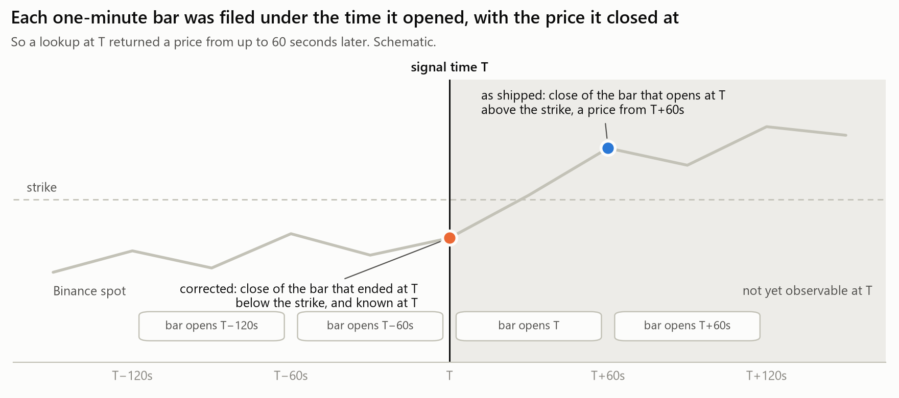
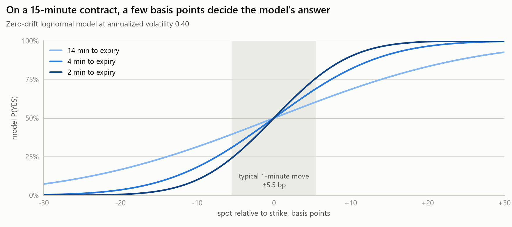
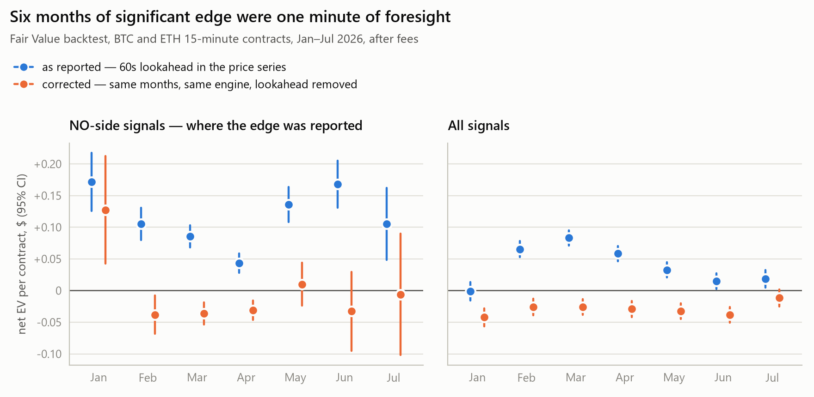
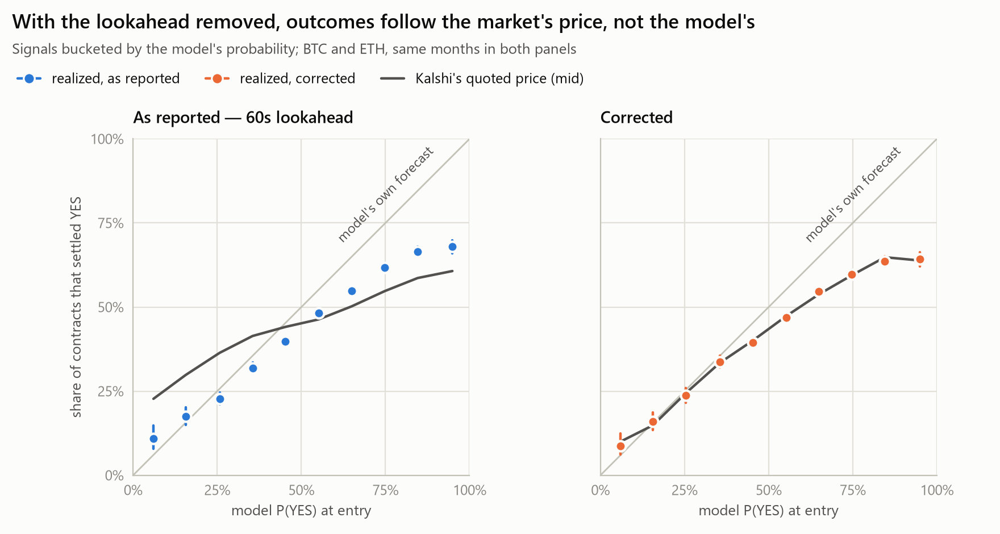
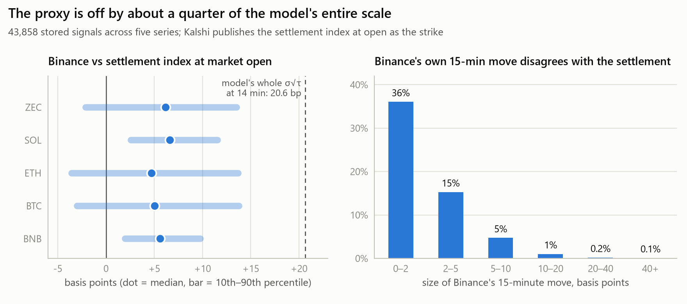
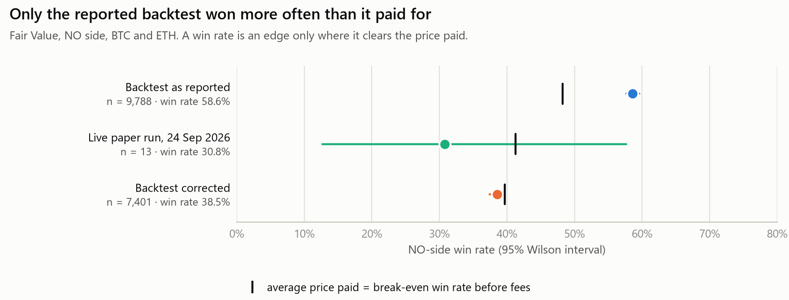
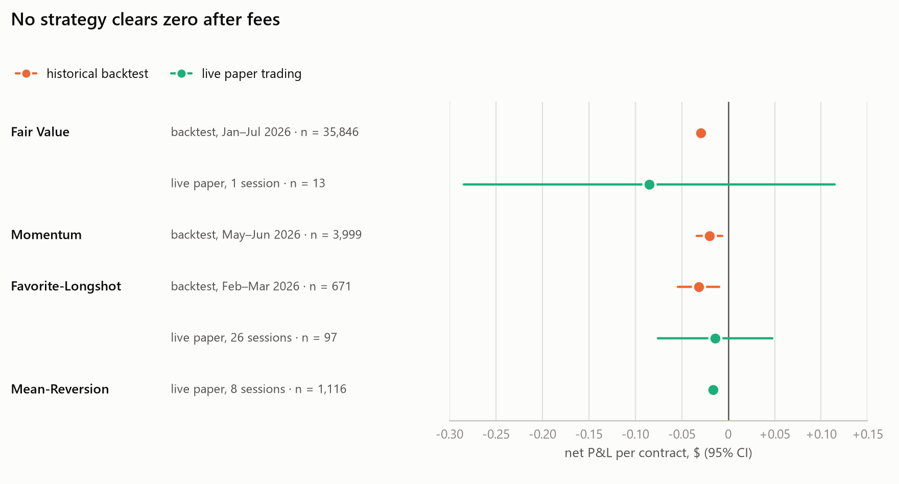

# Post-mortem: a six-month backtest edge that was 60 seconds of lookahead

The full analysis behind the [README](../README.md). Every number here comes from
the committed [`data/`](../data) snapshot and can be regenerated; the commands
are at the [end](#reproducing-every-number).

**Contents**

1. [Summary](#summary)
2. [What was claimed](#what-was-claimed)
3. [The bug](#the-bug)
4. [Why one minute was enough](#why-one-minute-was-enough)
5. [The corrected result](#the-corrected-result)
6. [Replaying the original signals](#replaying-the-original-signals)
7. [A second, independent problem: the basis](#a-second-independent-problem-the-basis)
8. [What flagged it: the live run](#what-flagged-it-the-live-run)
9. [What did not catch it, and what changed](#what-did-not-catch-it-and-what-changed)
10. [An earlier measurement error: mid-price fills](#an-earlier-measurement-error-mid-price-fills)
11. [The other three strategies](#the-other-three-strategies)
12. [Known limitations](#known-limitations)
13. [Reproducing every number](#reproducing-every-number)

## Summary

- The Fair Value strategy prices Kalshi's 15-minute BTC/ETH contracts as digital
  options and trades where the model disagrees with the market. Its backtest
  showed a NO-side edge of **+0.086 per contract over 9,563 signals**, positive
  and individually significant in each of six consecutive months.
- The edge was produced by a **60-second lookahead**. One-minute Binance bars
  were stored under their open time with their close price, so a lookup at time
  T returned a price from up to a minute later.
- With the lookahead removed, the same engine over the same months loses
  money: **−0.028 per contract on the NO side and −0.033 over all signals**,
  January to June, both with confidence intervals below zero. One month,
  January on the NO side, keeps a positive residual that this analysis does
  not explain; it is reported [below](#the-january-residual) rather than
  argued away.
- A second, independent problem remained: Binance spot differs from the index
  these contracts settle on by a median of 5.2 basis points, a quarter of the
  model's whole scale. Near the strike the proxy cannot resolve the payoff.
- A train/test split, an out-of-sample run, a fill-model correction and a
  cross-instrument screen all passed on the faulty data, because they shared
  it. A simulated live run was what disagreed. The repo now has an end-to-end
  test that would have caught the bug.

## What was claimed

Kalshi's `KXBTC15M` and `KXETH15M` contracts resolve YES if a reference price
at the close is at or above a strike fixed when the market opens. That is a
cash-or-nothing digital option on "does the price finish above where it
started". [`kalshi/utils/pricing.py`](../kalshi/utils/pricing.py) prices it in
closed form with a zero-drift lognormal model: spot and trailing realized
volatility from Binance, strike and time to expiry from Kalshi. The strategy
buys whichever side the model says is underpriced by more than 3 cents after
the entry fee, and holds to expiry.

As first reported, on BTC and ETH, NO-side signals only:

| Month (2026) | Signals | Win rate | Net EV per contract | z vs price paid |
|---|---|---|---|---|
| January | 351 | 68.1% | +0.171 | +7.1 |
| February | 1,294 | 61.3% | +0.105 | +8.8 |
| March | 2,726 | 58.5% | +0.085 | +10.7 |
| April | 3,617 | 53.7% | +0.043 | +7.3 |
| May | 1,029 | 65.1% | +0.136 | +9.9 |
| June | 546 | 66.7% | +0.168 | +8.7 |
| **January–June** | **9,563** | **58.6%** | **+0.086** | |

Six independent months, each significant on its own. The result also survived
a train/test split (train z = +3.9, test z = +6.2), a July cross-section over
eight instruments, and the correction of an unrelated fill-price error
([below](#an-earlier-measurement-error-mid-price-fills)).

All of it was wrong.

## The bug



Binance returns one-minute bars ("klines") as rows that start with the bar's
open time and contain its close price. The history loader stored each row as
`(open_time, close_price)`:

```python
# kalshi/data/binance_history.py, before the fix
out.append((open_time_ms, close_price))
```

`PriceSeries.spot_at(T)` then returned the most recent point at or before T.
That lookup was written correctly and tested. But a bar that opens at T does
not close until T+60s, so the point filed under T held a price from the
future. Every fair-value backtest priced off it, for both spot and the
volatility window.

The fix is one expression: key each close by the moment it became knowable.

```python
# after the fix
out.append((open_time_ms + interval_ms, close_price))
```

The live strategy was never affected. It reads the in-progress bar from
Binance's live endpoint, whose latest close is the current price. That
asymmetry is the whole gap between backtest and live.

## Why one minute was enough



The model's probability is `N(d2)` with `d2 ≈ ln(S/K) / (σ√τ)`. On a 15-minute
contract `σ√τ` is tiny. At an annualized volatility of 0.40, the July 2026
median:

| Time to expiry | `σ√τ` | P(YES) at −20 bp | at the strike | at +20 bp |
|---|---|---|---|---|
| 14 min | 20.6 bp | 16.6% | 50.0% | 83.3% |
| 4 min | 11.0 bp | 3.5% | 50.0% | 96.5% |
| 2 min | 7.8 bp | 0.5% | 50.0% | 99.5% |

One minute of BTC movement at that volatility has a standard deviation of
5.5 bp. Knowing the next minute therefore moves the model's probability by
around ten points at the long end of the window and far more near expiry.
That is the same size as the edge that was claimed.

## The corrected result



All seven months were re-run with the corrected loader: same engine, same
parameters, same markets. Only the price series changed.

| Month (2026) | NO signals | Win rate | Avg price | Net EV per contract (95% CI) | All signals: net EV |
|---|---|---|---|---|---|
| January | 99 | 44.4% | 0.302 | +0.128 (+0.043 to +0.212) | −0.042 |
| February | 666 | 28.8% | 0.311 | −0.038 (−0.069 to −0.008) | −0.026 |
| March | 2,320 | 35.4% | 0.374 | −0.036 (−0.054 to −0.019) | −0.026 |
| April | 3,568 | 43.5% | 0.449 | −0.031 (−0.047 to −0.016) | −0.029 |
| May | 597 | 35.5% | 0.330 | +0.010 (−0.024 to +0.044) | −0.033 |
| June | 108 | 22.2% | 0.242 | −0.033 (−0.095 to +0.030) | −0.039 |
| July | 43 | 18.6% | 0.182 | −0.006 (−0.102 to +0.090) | −0.012 |
| **January–June** | **7,358** | **38.7%** | **0.398** | **−0.028 (−0.038 to −0.018)** | **−0.033 (−0.038 to −0.027)** |

Three things changed at once. The NO side shrank and moved to cheaper
contracts (average price 0.40 instead of 0.48). The win rate fell from 58.6%
to 38.7%, now just below the price paid, so the strategy pays the fee and
loses it. And 79% of all corrected signals are on the YES side, where every
month loses after fees. Before fees the corrected strategy is close to zero
(−0.015 per contract over January to June); the market prices these contracts
about as well as the model can see.

### The January residual

January's NO side is the one cell out of fourteen (seven months, two sides)
with a positive interval after the correction: 99 signals, +0.128 per
contract. It does not go away under the obvious checks:

- **Clustering by day.** Signals on the same day share a price path, so the
  per-trade interval above is too narrow. A bootstrap over the 18 trading days
  that had a signal gives +0.037 to +0.211, still above zero.
- **Multiple comparisons.** Fourteen cells were looked at. With a Bonferroni
  correction for that, January stays marginally significant (p ≈ 0.03).
- **Both series.** BTC (+0.115, n = 64) and ETH (+0.151, n = 35) show it on
  their own.

What it does show is concentration. Three days (6, 14 and 15 January) carry
half of the trades and about 80% of the profit; without them the residual is
+0.056 with an interval from −0.053 to +0.165. The effect does not carry into
February, where the same side is significantly negative, and no later month
shows it. Pooled over all months the NO side is clearly negative.

The honest reading is an unexplained anomaly in a small sample, not an edge
that survived. It would need an independent test on data not yet seen, with
the rule fixed in advance, before anyone traded it.



The calibration chart shows where the edge came from. Signals are grouped by
the model's own probability; a correct model would put the dots on the
diagonal.

- **As reported**, outcomes ran well beyond Kalshi's price in both directions.
  Where the model said 15% the contracts settled YES 17% of the time while the
  market had quoted 30%; where it said 85% they settled YES 67% of the time
  against a quote of 59%. A model that knows the next minute beats the market
  at both ends.
- **Corrected**, the realized frequency sits on Kalshi's quote in every bucket,
  usually within a percentage point (at a model probability of 85%: market
  64.8%, realized 63.7%). The model is still confident, the market is right,
  and the gap between them is the model's overconfidence, not mispricing.

## Replaying the original signals

The corrected run selects different signals, so it does not say what happened
to the *original* ones. [`audit_fair_value.py`](../audit_fair_value.py) answers
that. It takes every stored NO signal at its own entry candle and recomputes
the model twice, once with the open-time lookup and once with the corrected
one. Quotes, entry time and settlement outcome are held fixed; only the spot
and volatility inputs change. A row is used only if the first recomputation
reproduces the stored edge to within half a cent, which proves the replay
matches the run that produced it.

Across BTC, ETH, BNB, SOL and ZEC, 10,553 stored NO signals could be replayed
(88 SOL rows could not be reproduced and are excluded):

| Lookup | Signals still clearing 3 cents | Edge the model claimed | Edge realized | Win rate |
|---|---|---|---|---|
| With lookahead | 10,553 (100%) | +0.103 | +0.105 | 58.4% |
| Without | 3,091 (29.3%) | +0.077 | +0.042 | 47.8% (95% CI 46.0–49.5) |

Two caveats. The EV columns are before fees (about 2 cents per contract), and
the surviving signals are conditioned on the faulty signal having fired at
that candle, so they are a biased subsample. The corrected run above is the
authoritative number; the replay shows the mechanism.

The first row is the instructive one. Claimed and realized edge agreed to
within a fraction of a cent. The model looked well calibrated because it knew
the next minute.

## A second, independent problem: the basis



Removing the lookahead did not make the model agree with the market. It still
signals on nearly every market, almost always YES, so something else pushes
its probability up.

These contracts settle on a CF Benchmarks index, not on Binance. Kalshi
publishes that index's value at market open as the contract's `floor_strike`,
so the basis between the Binance proxy and the settlement index is measurable
without any external data:

```
basis_bp = 10000 * (binance_at_open / floor_strike - 1)
```

| Series | Rows | 10th pct | Median | 90th pct |
|---|---|---|---|---|
| BTC | 19,337 | −3.0 bp | +5.0 bp | +13.8 bp |
| ETH | 17,908 | −3.6 bp | +4.7 bp | +13.7 bp |
| SOL | 2,364 | +2.6 bp | +6.6 bp | +11.5 bp |
| BNB | 2,361 | +2.0 bp | +5.6 bp | +9.8 bp |
| ZEC | 1,888 | −2.1 bp | +6.2 bp | +13.5 bp |
| **Pooled** | **43,858** | **−3.0 bp** | **+5.2 bp** | **+13.5 bp** |

A systematic +5 bp offset and a spread of about 16 bp, against a model whose
entire scale is 20.6 bp at 14 minutes. The offset alone shifts `d2` by +0.25
and P(YES) by roughly ten points, which matches the direction and size of the
model's overconfidence in the calibration chart above.

The anchoring was checked two ways. The derived market-open times fall on a
15-minute boundary in every row. And the spread of the basis is smallest at
offset zero and grows symmetrically when the comparison is shifted by one or
two minutes either way, while the median stays between +4.6 and +5.1 bp. So
this is a real level difference between two price sources, not a timing error.

The consequence is a floor that tuning cannot get under. Comparing the sign of
Binance's own 15-minute move with how Kalshi actually settled:

| Size of Binance's move | Markets | Disagrees with settlement |
|---|---|---|
| 0–2 bp | 4,215 | **36.1%** |
| 2–5 bp | 6,125 | 15.3% |
| 5–10 bp | 9,089 | 4.7% |
| 10–20 bp | 11,208 | 1.0% |
| 20–40 bp | 8,498 | 0.2% |
| over 40 bp | 4,723 | 0.1% |

Near the money the proxy carries little information about the payoff, and that
is where most of the signals are. No model built on Binance spot can have an
edge within about 10 bp of the strike. Further out, the market already prices
the outcome correctly.

## What flagged it: the live run



The NO-side signal was run as simulated trading against live quotes on
24 September 2026, for two hours: **13 trades, 4 wins, −$525** on a $10,000
paper account. All 13 were held to expiry.

Thirteen trades prove nothing on their own, and this run was not read as
proof. It was read as a consistency check, and it failed one:

- The reported backtest won 58.7% of July NO trades at an average price of
  46 cents. The live run won 30.8% at an average price of 41 cents. Its 95%
  interval, 12.7% to 57.6%, sits just below the backtest's figure.
- The live run found a NO signal in 13 of the 14 markets it saw. In the July
  backtest only 11.7% of signals were on the NO side.

Both comparisons are weaker than they look, and the reason matters. The live
run trades NO only and re-evaluates each market on every poll until a NO
signal appears. The backtest records the first signal on either side, once per
market, on one-minute candles. So "13 of 14" and "11.7%" are not the same
quantity, and the live trades were not drawn from the same population as the
backtest's NO signals. On expected value alone the run could not reject the
claim either: it lost 8.5 cents per contract with a 95% interval of −28 to
+11 cents, which still contains the +10.5 cents the July backtest claimed.

What the run did show was a strategy losing money where its backtest said it
should win clearly. That was enough to stop trusting the backtest and read the
price lookup line by line instead of re-running it, which is how the bug was
found on 9 October.

After the fix, the live run and the corrected backtest tell the same story:
the corrected NO side wins 38.5% of the time against an average price of 39.7
cents, and the live run won 30.8% against 41 cents. Neither clears its price.
The selection caveat above still applies, so this is agreement in direction,
not a test.

For scale: telling a 58.6% win rate from 50% with 80% power needs about 200
trades, so a live run was never going to confirm the edge quickly. It could
only contradict it.

## What did not catch it, and what changed

Every check that passed on the faulty data had the same blind spot.

| Check | Result on faulty data | Why it could not see the bug |
|---|---|---|
| Train/test split | train z = +3.9, test z = +6.2 | The held-out data has the same timestamps |
| Six separate months | all six significant | Same loader every month |
| Eight instruments | positive on all | Same loader for every symbol |
| Fill-model correction | effect size unchanged | Independent error, different code path |
| Unit tests | all passing | `PriceSeries` and the engine were each correct; the error was in how raw bars became timestamps between them |

Statistical validation tests whether a pattern in the data is stable. It
cannot test whether the data could have been known at the time.

What the repo has now:

- **An end-to-end no-lookahead test**
  ([`tests/test_no_lookahead_e2e.py`](../tests/test_no_lookahead_e2e.py)). It
  feeds each backtest engine its raw API payloads, records the signal at entry
  time T, then rewrites every input that was not observable at T, and requires
  the identical signal. It makes no assumption about where a lookahead could
  hide. The same test runs against the old open-time keying and must fail
  there, which shows it would have caught this bug.
- **The audit script**, which measures the lookahead and the basis from stored
  observations.
- **A committed data snapshot** in `data/`, so every figure and table here can
  be rebuilt and checked without API access.
- **A plausibility guard** on the strike. Kalshi has returned `floor_strike`
  wrong by four orders of magnitude (0.22 instead of 2,229.30 on 13 April
  2026); such rows are skipped instead of priced.

## An earlier measurement error: mid-price fills

Before the lookahead was found, a first error had already been corrected. All
three backtest engines originally filled trades at the midpoint of Kalshi's
bid and ask. Nobody can trade there: buying YES costs the ask, buying NO costs
one minus the YES bid. The midpoint overstates edge by about half the spread
on every trade. Spreads on these markets are tight (median 1 cent, 90th
percentile 3 to 4 cents), so the damage was real but bounded.

Results as recorded at the time, before and after that fix:

| Strategy | Sample | Mid-price fills | Executable-price fills |
|---|---|---|---|
| Momentum, NO side | 800 markets | win rate 75.8%, z = +2.14 | win rate 65.7%, z = −0.31 |
| Momentum, NO side | out-of-sample, n = 2,000 | z = +2.16 | z = +1.43, EV ≈ 0 |
| Fair Value, NO side | 800 markets | n = 120, win rate 70.0%, z = +4.88 | n = 31, win rate 74.2%, z = +2.26 |
| Fair Value, NO side | out-of-sample | n = 284, EV +0.224, z = +8.15 | n = 233, EV +0.221, z = +7.30 |

Momentum's apparent edge was a mid-price artifact and disappeared. Fair
Value's survived at the same effect size, which at the time looked like
confirmation. It was not: the two errors were independent, and passing one
correction said nothing about the other. The Fair Value rows in this table
still contain the lookahead and are kept only as a record.

The engines now record every outcome at the executable quote, and the fee is
rounded up to the cent on the whole order, as Kalshi charges it. Entry filters
that describe market consensus, such as Longshot's "YES mid at least 0.85",
still use the midpoint.

## The other three strategies



### Momentum: no edge

Bets that a move in the contract's own price continues into expiry. After the
fill-model fix, out-of-sample on 16 May to 6 June 2026 (n = 3,999): win rate
67.7% at an average price of 68.2 cents, net EV −0.020 per contract. The NO
side alone is flat (n = 2,000, EV −0.000, z = +1.43, not significant); the YES
side loses (EV −0.040). The entry rule was also never selective. A 2% move in
the trailing window fires on nearly every market, so the signal describes
ordinary market behavior and not a rare pattern.

### Favorite-Longshot: no edge, and the session effect did not replicate

Buys NO on heavy favorites (YES mid at least 0.85), on the idea that bettors
overpay for near-certainties. It reads Kalshi candles only, so the Binance
lookahead never touched it; the mid-price fill error did.

The original backtest (February and March 2026, mid-price fills) found no
general bias but one positive window out of four sessions: the US open, 13:30
to 15:30 UTC, with a NO win rate of 15.7% and z = +2.51. Four sessions tested
and one significant at that level is close to what chance produces, which was
the reason to re-run it.

The same window, re-run with the corrected engine:

| Session (UTC) | NO trades | Win rate | Avg price | Net EV per contract (95% CI) |
|---|---|---|---|---|
| US open, 13:30–15:30 | 70 | 18.6% | 0.115 | +0.064 (−0.028 to +0.156) |
| US session | 149 | 8.1% | 0.121 | −0.048 (−0.092 to −0.005) |
| EU session | 182 | 9.9% | 0.120 | −0.029 (−0.073 to +0.015) |
| Off hours | 270 | 8.2% | 0.124 | −0.050 (−0.082 to −0.017) |
| **All sessions** | **671** | **9.7%** | **0.121** | **−0.032 (−0.054 to −0.010)** |

The US-open point estimate is still positive, but its interval includes zero,
and that is before any correction for having picked the best of four
sessions. Across all sessions the strategy loses. The live test agrees: it ran
in exactly the US-open window for 26 sessions and won 13 of 97 trades (13.4%)
at an average price of 12.4 cents, −1.4 cents per contract (95% interval −7.6
to +4.7), −$1,615 in total. The scheduled run was stopped.

### Mean-Reversion: no edge

Buys YES after a fall that shows signs of recovering, NO after a rise that
shows signs of fading, with a take-profit at 1.5 cents and a stop-loss at 2.5
cents. A one-minute candle cannot say whether the take-profit or the stop was
hit first inside the minute, so this strategy was validated by simulated live
trading only. Over 8 sessions and 1,116 trades in May 2026 it won 49.4% of the
time and lost $3,201, or 1.6 cents per contract (95% interval −2.2 to −1.0).
Winning half the time while risking more than is gained loses money.

## Known limitations

**Order-book depth is not modeled.** Backtests fill at the touch regardless of
size. Kalshi's historical candlestick API exposes no depth, so this cannot be
measured after the fact. Position sizes here are small (1% of a $10,000
account, a few hundred contracts), where walking the book is unlikely to
matter, but the assumption is unverified.

**Taker fees are assumed on every fill.** That is the conservative direction.
A limit-order variant would need a fill-probability model, which does not
exist here.

**The fee formula is corroborated, not primary-sourced.** `fee_multiplier` and
`fee_type` were read from Kalshi's live API for both series, and rounding up
to the cent matches several independent descriptions and a published
reference point ($1.75 per 100 contracts at 50 cents). Kalshi's own fee
schedule PDF could not be fetched at the time (HTTP 429).

**One venue, limited history.** Everything rests on Kalshi 15-minute crypto
series between January and July 2026. Stored `spot` and `strike` values were
rounded to two decimals, which is too coarse to audit low-priced underlyings
such as XRP and DOGE after the fact.

**The live run and the backtest select signals differently.** See
[above](#what-flagged-it-the-live-run). A backtest mode that mirrors the live
NO-only rule would make the two directly comparable; it does not exist yet.

**Binance spot cannot resolve these contracts near the strike.** This is
measured, not suspected. A future strategy needs the actual CF Benchmarks
index, or has to stay well outside 10 bp of the strike, where the market is
already right.

**No strategy in this repo has a demonstrated edge.** What the repo
demonstrates is the validation machinery.

## Reproducing every number

From a fresh clone, with no API key:

```bash
pip install -r requirements.txt
python make_figures.py --tables      # all figures, plus the before/after tables
python audit_fair_value.py --out-dir data data/fair_value/with_lookahead/2026-*.csv.gz
pytest -q
```

The audit fetches public Binance klines; nothing else touches the network.
[`analysis.ipynb`](../analysis.ipynb) walks through the same results with the
code inline.

To regenerate the raw observations themselves (needs Kalshi API credentials
and about an hour per month of data):

```bash
python backtest_fair_value.py --from 2026-03-01 --to 2026-03-31 --max-markets 100000 --csv results/fixed_2026-03.csv
python backtest.py --from 2026-02-01 --to 2026-03-31 --max-markets 100000 --csv results/longshot_febmar_fixed.csv
python export_data.py                # results/ + trading.db -> data/
```

The "as reported" files under `data/fair_value/with_lookahead/` were produced
by the engine before commit `2aae35d` and cannot be regenerated with the
current code; that is the point of keeping them.
